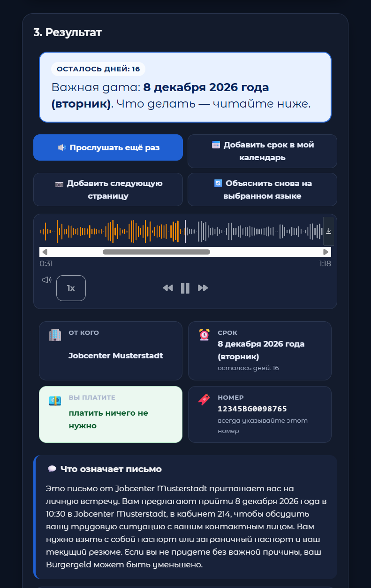
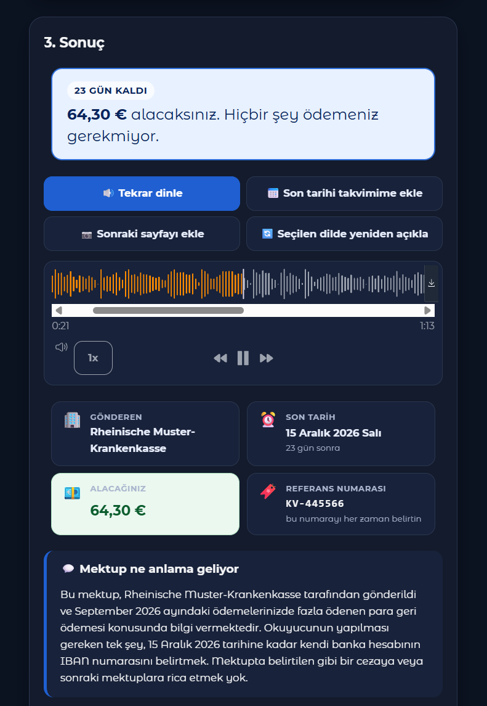

# Amt-Lotse
[](https://github.com/achref-2/amt-lotse/actions/workflows/ci.yml)
[](LICENSE)

**An AI assistant that explains German official letters — from a photo, in your language, out loud, and privately on your own machine.**

Letters from the Jobcenter, the Krankenkasse, the Finanzamt or the Ausländerbehörde are hard to understand, even with good German. For many people they are much harder:

- **new immigrants** who are still learning German,
- **blind and visually impaired people** who cannot read a paper letter,
- **older people** who find small print and official language overwhelming.

Amt-Lotse reads the letter — as text, PDF or **a photo**, in a simple **web UI** or on the command line — and tells you in simple words: **who sent it, the deadline, how much you have to pay (or receive), and what you have to do**. In **8 languages** (English, French, Arabic, Turkish, Ukrainian, Russian, Persian and simple German), **read aloud** if you want, and it can **draft a reply** in formal German.

## Screenshots
All screenshots use fictional test letters from `data/`.

**1. Start page: pick a language, take a photo — or try an example letter with one tap**


**2. Result in English: checked facts first, then audio, then the explanation**


**3. The same in Arabic — card, audio and explanation in the user's language (right-to-left)**


**4. Russian and Turkish: an appointment at the Jobcenter, and a refund from the health insurance**

<p>


</p>

**Progress is shown step by step, in the chosen language, so nobody thinks "nothing is happening"**


## Why local first?
Official letters contain private data (IDs, addresses, tax numbers).
Amt-Lotse runs local models via [Ollama](https://ollama.com) and [Piper](https://github.com/OHF-Voice/piper1-gpl), so **your letters never leave your machine** — no cloud API, no account.
(The optional [always-online version](#always-online-website--phone-app-ai-on-your-pc) keeps the AI on your PC too: letters travel encrypted from your phone to your PC, and the page says so.)

## Example
A scanned debt reminder (`data/photos/mahnung_01_scan.png`):

```text
$ uv run amt-lotse data/photos/mahnung_01_scan.png

Reading the photo with qwen2.5vl:3b ...

============================================================
  From:       Muster Mobilfunk GmbH
  Subject:    2. Mahnung
  Deadline:   04.12.2026  (in 14 days)
  You pay:    56,13 €
  Reference:  RE-2026-08812  (always quote this number)
============================================================

What this means:

The letter is from Muster Mobilfunk GmbH, a company in Musterstadt, to Herr Max
Beispiel. It is a second reminder about an unpaid invoice. Herr Beispiel needs to
pay 56.13 euros by December 4, 2026. If he does not pay on time, the company will
hand over the case to a debt collection agency, which will result in additional costs.
```

Add `--speak` to hear it, `--lang ar` for Arabic, `--reply installments` for a reply draft.

## Features
- **Clear start page** – language first, then one big photo button; a short introduction, "how it works" and
  why it can be trusted, all in the chosen language. Example letters start with one tap, the result shows the facts
  as a card (sender, deadline, amount, reference number), and **🔄 Explain again** redoes it in another language
  without uploading again. Dark mode, high contrast and phones (one column, two-column language grid) included.
- **Any input** – `.txt`, PDF (digital text is read directly, scanned pages via OCR), photos (`.jpg`, `.png`)
- **Multi-page letters and attachments** – several photos or files are read as one letter, in order
  (e.g. the letter plus its *Rechtsbehelfsbelehrung* or payment form). In the web UI: pick all pages at once,
  or **📷 Add the next page** after the first. An unreadable page is taken out and named, so only that one
  has to be photographed again.
- **Context sized to the letter** – Ollama's default context is ~4000 tokens and it silently drops the
  *beginning* of longer prompts, which is where the deadline and amount are. Every model call asks for a
  context that fits the letter (up to 16k tokens); letters beyond ~15 pages are cut at the end instead, with a warning.
- **Local OCR** with a vision model (Qwen2.5-VL 3B); unreadable or cut-off photos are detected → "take the photo again"
- **Structured extraction** – sender, deadline, amount, reference number, required action (JSON schema output)
- **Plain-language explanation** in English, French, Arabic, Turkish, Ukrainian, Russian, Persian (Farsi) or simple German
  (`--lang en|fr|ar|tr|uk|ru|fa|de`) – the languages of the largest immigrant groups in Germany. Arabic and Persian are
  shown right to left; the code checks that the model really answered in the chosen language (Russian vs. Ukrainian,
  Arabic vs. Persian included) and asks again if not
- **Read aloud** (`--speak`), designed for accessibility:
  - key facts first, built from the checked extraction (not from free LLM text)
  - dates and amounts spoken as words, reference numbers spelled out
  - slower speech by default, the most important point repeated at the end
  - saved as `.wav`, so it can be replayed or sent to someone
- **Reply drafts** (`--reply`) in formal German: ask for more time, installments, say you already paid, ask for a new appointment, ask a question
  - letter frame (reference number, dates, subject, greeting) built by code; the LLM only writes the body
  - unknown details stay as `[placeholders]`; dates/amounts the LLM invents are detected and replaced with placeholders
  - your own note in any language (`--note "I am sick until 10 December"`) is used and translated
  - a short explanation of the draft in your language
- **Guardrails** on top of the LLMs:
  - yes/no gating for deadlines (an info date is not a deadline)
  - rule-based payment detection: the letter's own wording decides who pays ("überweisen Sie …" vs. "Guthaben", "Erstattung")
  - an amount that exists but cannot be read is shown as **unclear** — never as "you pay nothing"
  - language and script check with automatic retry
- **Evaluation harness** with hand-labelled test letters

## Web UI
```bash
uv run amt-lotse-ui              # opens http://127.0.0.1:7860 — only reachable from this computer
uv run amt-lotse-ui --lan        # also from your phone on the same Wi-Fi (password protected)
uv run amt-lotse-ui --tailscale  # phone app with HTTPS, at home and on the way (password protected)
uv run amt-lotse-ui --funnel     # always online from anywhere, with a status page (see "Always online")
```

Language choice, a camera button, photo/PDF upload, one-click example letters, a big "Explain" button,
step-by-step progress, auto-playing audio, a "what the computer read" panel for a helper to check,
and the reply drafts with copy and download.

## Voice input
Under the result there is **Ask a question about this letter**: press 🎤, ask in your own language
("What happens if I don't pay?"), and the answer is shown and read aloud. The note for a reply letter
can be spoken too.

- Speech is turned into text **offline** with [faster-whisper](https://github.com/SYSTRAN/faster-whisper)
  (model `small`, about 0.5 GB, downloaded once). Smaller/faster: `$env:AMT_LOTSE_WHISPER_MODEL="base"`.
- The question is answered **only from the letter**. If the letter doesn't say it, the answer says so and
  points to the office or an advice centre: no guessing, no general legal advice.
- Dates and euro amounts in an answer must appear in the letter; otherwise the model is asked again,
  and if it still invents one, the safe "the letter does not say this" answer is used.
- Same from the command line: `--ask "What if I don't pay?"` or `--ask-voice question.wav`,
  and from AI assistants with the MCP tool `ask_about_letter`.
- Browsers only allow the microphone on `localhost` or HTTPS, so on a phone use `--tailscale` or
  `--cert/--key` (plain `--lan` can still type questions).

## Public link (for a demo)
```bash
uv run amt-lotse-ui --share
```
Gradio creates a temporary public address (`https://….gradio.live`) that works from anywhere, shown as text and as
a QR code with a fresh password. Meant for showing Amt-Lotse to someone, e.g. in an interview:

- **Always password protected** – the link alone would let anyone use your computer's models.
- **Letters leave your computer:** they travel through Gradio's share servers. Use only made-up test letters
  while the link is on. For your own letters on your phone, use `--tailscale` instead (stays private).
- The link ends when you press Ctrl + C (at most about a week). The first start downloads Gradio's small tunnel
  program (`frpc`); some antivirus programs block it — then allow it, or use `--tailscale`.

## Phone app
Amt-Lotse can be installed on a phone like an app: its own icon on the home screen, full screen, and a big
**📷 Take a photo of the letter** button that opens the back camera directly. The models still run only on
your computer: the phone sends the photo there and nowhere else.

The terminal shows the address as a **QR code**, plus a user name and a fresh password. Point the phone
camera at the code, log in, then use the browser menu: **Install app** (Android/Chrome) or
**Share → Add to Home Screen** (iPhone/Safari).

Phones only install a real app from an **HTTPS** address. Pick one way:

| Way | How | Good for |
|---|---|---|
| **Tailscale** (easiest) | Install [Tailscale](https://tailscale.com/download) on the computer and the phone, same account. Run `tailscale serve --bg 7860` once, then `uv run amt-lotse-ui --tailscale`. The first `serve` may ask you to turn on HTTPS for your tailnet (one click). | Valid HTTPS with no certificate work; also works away from home; only your own devices can reach it |
| **Own certificate** | `mkcert 192.168.178.23` (your Wi-Fi address), install mkcert's root certificate on the phone once, then `uv run amt-lotse-ui --lan --cert 192.168.178.23.pem --key 192.168.178.23-key.pem` | Home Wi-Fi only, no extra account |
| **Plain `--lan`** | `uv run amt-lotse-ui --lan` | Quick use in the phone's browser; "Add to Home screen" makes a shortcut, not a full app |

Use the phone modes only in networks you trust. Windows may ask once whether Python may accept
connections in private networks. Set `AMT_LOTSE_PASSWORD` to keep the same password between starts.

## Always online (website + phone app, AI on your PC)
The start page is always online, on Wi-Fi or 4G: **https://achref-2.github.io/amt-lotse/**. The app and the AI run
on your PC. When the PC is on, the page shows **"AI ready"** and an **Open Amt-Lotse** button; when it is off, it says
**"The AI server is off"** in the chosen language.

```
phone / browser ──▶ achref-2.github.io/amt-lotse  (static page, always online, asks "is the AI on?")
               └──HTTPS──▶ https://<your-pc>.<tailnet>.ts.net  (Tailscale Funnel) ──▶ your PC: app + Ollama
```

**Privacy:** letters go encrypted straight to your PC. Tailscale's relays only pass the encrypted data on and
cannot read it; no AI company and no hosting service sees the letters. The app is public but password protected.
The only page without a password is `/amt-status`, which says nothing but whether the AI is on.

**On your PC (once)**
1. Install [Tailscale](https://tailscale.com/download), sign in, and let Ollama and Tailscale start with Windows.
2. Choose a password (at least 10 characters) and store it for your user:
   `setx AMT_LOTSE_PASSWORD "your-password"` (then open a new terminal).
3. Start: double-click [`scripts/start-online.cmd`](scripts/start-online.cmd) (or `uv run amt-lotse-ui --funnel`).
   The first time, Tailscale may print a link to allow Funnel and HTTPS for your tailnet: open it, click *Enable*,
   start again. The window shows your address (`https://<your-pc>.<tailnet>.ts.net`) and a QR code.
4. Start it with Windows: press `Win + R`, type `shell:startup`, and put a shortcut to `scripts/start-online.cmd` there.
   Set Windows to never sleep while plugged in.

**The status page (once)**: build it with your address, push, then turn on GitHub Pages
(*Settings → Pages → Deploy from a branch → main, /docs*):
```bash
uv run python scripts/build_status_page.py https://<your-pc>.<tailnet>.ts.net
```

**On the phone**: open the status page, tap *Open Amt-Lotse*, log in (user `amt`), then *Install app* /
*Add to Home Screen*.

## Install with Docker (one command)
Needs [Docker Desktop](https://www.docker.com/products/docker-desktop/). Everything stays on your computer.

```bash
docker compose up --build
```
Then open http://127.0.0.1:7860. The first start downloads ~10 GB of models once (kept in a Docker volume).

| Situation | Command |
|---|---|
| Nothing installed except Docker | `docker compose up --build` |
| NVIDIA graphics card | `docker compose -f docker-compose.yml -f docker-compose.gpu.yml up --build` |
| Ollama already installed on your computer (no second download) | `docker compose -f docker-compose.host-ollama.yml up --build` |

The UI port is published on `127.0.0.1` only. A typical real-world setup: one machine at an advice centre or care home runs Amt-Lotse in Docker, and people use it from their phones over the local Wi-Fi.

Tips: on Windows, move Docker's disk image to a drive with space (*Settings → Resources → Advanced → Disk image location*). If Ollama crashes with a CUDA error while switching models, set `OLLAMA_MAX_LOADED_MODELS=1`.

## Quick start (without Docker)
Requirements: Python 3.14+, [uv](https://docs.astral.sh/uv/), [Ollama](https://ollama.com)

```bash
ollama pull qwen2.5:3b       # reads the letter
ollama pull qwen2.5:7b       # writes explanations and replies
ollama pull qwen2.5vl:3b     # reads photos and scans
uv sync

uv run amt-lotse data/eval/mahnung_01.txt                          # English
uv run amt-lotse data/photos/jobcenter_01_photo.jpg --lang ar --speak  # photo, Arabic, read aloud
uv run amt-lotse seite1.jpg seite2.jpg anlage.pdf      # several pages / attachments = one letter
uv run amt-lotse data/eval/mahnung_01.txt --reply installments     # reply draft
```

Voices for `--speak` are downloaded automatically on first use (into `voices/`).

| Option | Effect |
|---|---|
| `--lang en\|fr\|ar\|tr\|uk\|ru\|fa\|de` | language of the explanation, audio and reply summary |
| `--speak` | read aloud and save as `audio/<letter>_<lang>.wav` |
| `--ask "…"` / `--ask-voice file.wav` | a question about the letter, typed or spoken, answered only from the letter |
| `--normal-speed` | normal speaking speed (default is slower) |
| `--no-play` | only save the audio file |
| `--reply more-time\|installments\|already-paid\|reschedule\|question` | draft a German reply into `replies/` |
| `--note "..."` | your own information for the reply, in any language |

Models can be changed with `AMT_LOTSE_MODEL` (extraction), `AMT_LOTSE_EXPLAIN_MODEL` (explanation and replies) and `AMT_LOTSE_OCR_MODEL` (photos).

## MCP server (use it from AI assistants)
Amt-Lotse is also an [MCP](https://modelcontextprotocol.io) server, so AI assistants such as Claude Desktop, IDEs
or local agents can use it as tools — e.g. *"What do I have to do with the letter in my Briefe folder?"*

| Tool | What it does |
|---|---|
| `list_letters` | letters (text, PDF, photos) in the allowed folders |
| `get_letter_facts` | code-checked facts: sender, deadline, days left, amount to pay/receive, reference number, one "what to do" sentence |
| `explain_letter` | facts + plain-language explanation in 8 languages (local model) |
| `ask_about_letter` | answers a question using only what the letter says; says so when the letter doesn't answer it |
| `draft_reply` | formal German reply with `[placeholders]`; invented numbers are replaced |
| `create_calendar_reminder` | `.ics` file with reminders 3 days and 1 day before the deadline |
| `read_letter_text` | the full letter text — separate on purpose, see privacy |

Add it to your MCP client, e.g. Claude Desktop (`claude_desktop_config.json`):
```json
{
  "mcpServers": {
    "amt-lotse": {
      "command": "uv",
      "args": ["--directory", "D:\\Projects\\amt-lotse", "run", "amt-lotse-mcp"],
      "env": { "AMT_LOTSE_LETTER_DIRS": "C:\\Users\\you\\Documents\\Briefe" }
    }
  }
}
```

- **Local-first:** OCR, extraction, the rule checks and the explanation all run locally. By default the tools return results, not the whole letter.
- **Privacy:** if the assistant is a cloud model, whatever a tool returns is sent to that cloud. For full privacy, use a local MCP client.
- **Security:** only files inside the allowed folders can be read (default: `data/` and `Documents/Briefe`); `../` tricks and other folders are rejected.

## Architecture

```text
letter (.txt / .pdf / photo)
   │
   ├─ OCR (Qwen2.5-VL 3B, only for photos and scanned pages) ──► truncation / quality check
   ▼
extract (Qwen2.5 3B, JSON schema) ──► rule-based guardrails ──► summary card
   │
   ├──► explain (Qwen2.5 7B, chosen language) ──► language/script check
   ├──► reply   (Qwen2.5 7B body + code-built frame) ──► invented-number check
   └──► speak   (Piper TTS, offline) ──► audio/*.wav
```

| File | Role |
|---|---|
| `src/amt_lotse/ocr.py` | text from `.txt`, PDF or photo; OCR with a local vision model |
| `src/amt_lotse/extract.py` | LLM extraction, date/amount parsing, guardrails |
| `src/amt_lotse/app.py` | Gradio web UI |
| `src/amt_lotse/mcp_server.py` | MCP server: the pipeline as tools for AI assistants |
| `src/amt_lotse/pipeline.py` | shared pipeline for the UI, summary card in 8 languages |
| `src/amt_lotse/cli.py` | `amt-lotse` command, explanation, language check |
| `src/amt_lotse/reply.py` | reply drafts in formal German |
| `src/amt_lotse/speak.py` | spoken script in 8 languages, Piper TTS (offline voices, downloaded once per language) |
| `src/amt_lotse/evaluate.py` | scores the extractor against `data/eval/` |
| `src/amt_lotse/evaluate_text.py` | rule-based checks for explanation and reply texts |

## Evaluation
`uv run python -m amt_lotse.evaluate` scores the extractor against 12 hand-labelled letters in `data/eval/` (Jobcenter, Ausländerbehörde, Finanzamt, Krankenkasse, Beitragsservice, landlord, university, debt reminder).

The test letters contain deliberate traps: several dates where only one is a deadline, a refund that looks like a payment, invoice + fees + total, two reference numbers, amounts like `1.343,27 €`, and a relative deadline ("innerhalb von vier Wochen").

| Model | Fields correct | Time (12 letters) |
|---|---|---|
| qwen2.5:3b + guardrails | **36/36** | ~35 s |

### Explanation and reply texts
`uv run python -m amt_lotse.evaluate_text --lang en` (or `fr`, `ar`, `tr`, `uk`, `ru`, `fa`, `de`) runs the full pipeline on all eval letters and checks the free text with rules — no human labels, no "LLM judge":

| Explanation | Reply draft |
|---|---|
| mentions the right deadline and amount | no invented dates/amounts left |
| no invented dates or amounts | first person singular ("ich", never "wir") |
| no false reassurance ("nothing will happen", "does not specify") | formal "Sie", never "du" |
| right language and script | exactly one closing, reference number included, 1–6 sentences |

It also counts how often the guardrail had to replace numbers the model invented in a reply. A JSON report with every text is written to `eval_results/`.

**Latest run** (English, 12 letters, Qwen2.5 7B for the texts, ~14 min):

| Part | Result |
|---|---|
| Explanations | **64/64** checks — right deadline and amount every time, nothing invented, no false reassurance |
| Replies | 67/72 checks with the first version of the rules |

Reading the failed replies changed both the rules and the guardrail:
- 4 of the 5 "not first person" failures were correct German ("…wenn **wir** den Termin verschieben könnten" = you and I). The check now only fails if the writer never speaks as "ich" — which leaves 1 real failure (a whole letter written as "Wir …").
- 2 instalment replies said "in **drei** Monatsraten": an invented number, written as a word, that neither the guardrail nor the eval had seen. Number words (*zwei* … *zwölf*) not in the letter are now replaced with `[Anzahl]` as well.

Rules cannot catch every meaning error: an explanation that mixes up the appeal period (*Einspruch*) with a payment consequence still passes, and small grammar mistakes in the German replies ("in einem einzigen Überweisung") are not checked. Those are the next things to measure.

What the extraction eval taught us:
- The small model reads amounts and dates well, but is **unreliable on who pays** — it flipped between runs and between `.txt` and PDF versions of the same letter. That decision is now made by rules on the letter's own wording.
- 3B and 7B scored the same on extraction, with 3B about 5× faster → 3B extracts, 7B writes (3B often failed to answer in Arabic).

`data/photos/` contains a scan, a tilted phone photo, a digital PDF and a scanned PDF made from the test letters. All test letters are fictional and marked as test data.

## Knowledge base (RAG) against meaning errors
The explanations sounded fluent but sometimes got the **meaning** of official terms wrong. Real examples from
the evaluation before RAG:

| Letter says | Model wrote | Why it matters |
|---|---|---|
| *Einspruch innerhalb eines Monats nach seiner **Bekanntgabe*** | "within one month of the **letter's date**" | the period starts when the letter counts as delivered, not on the printed date |
| a tax demand with a *Rechtsbehelfsbelehrung* | did not say that **an Einspruch does not stop the payment** | someone could object, not pay, and get late charges |
| *übergeben wir die Forderung an ein **Inkassounternehmen*** | "an **enforcement agency**" | Inkasso is a private company without special rights; "enforcement" sounds like the state |
| a request for documents, no consequence stated | "failure to do so may result in delays" | an invented consequence |

**How it works:** `src/amt_lotse/knowledge/` holds 16 short, hand-written entries (Bekanntgabe, Einspruch, Widerspruch,
Inkasso, Vollstreckung, Mahnung, Jobcenter appointments, Betriebskosten, Aufenthaltstitel, Rundfunkbeitrag …),
each with **sources** (law texts on gesetze-im-internet.de, Verbraucherzentrale, Arbeitsagentur). The terms that
appear in a letter select up to 3 entries, which go into the explanation and question prompts as *background*,
with the instruction to use them only to explain terms correctly — never to take dates, amounts or consequences
from them.

- **Keyword retrieval on purpose:** official letters use fixed legal words, so matching them finds the right entry
  reliably, needs no extra embedding model, runs instantly and can be tested in CI. Tests check, for example, that a
  tax decision gets *Einspruch* and not *Widerspruch*, and that a request for documents gets no "objection" entry.
- **No numbers in the knowledge:** entries contain no amounts, percentages or dates (a test enforces this). They go
  out of date — the Jobcenter sanction rules changed in July 2026 — and the letter itself says what applies.
- **Measured, not assumed:** `data/eval/*.meaning.json` describes, per test letter, what the explanation must say
  ("the tax must still be paid even with an Einspruch") or must not say ("enforcement"). Compare:
  ```bash
  uv run python -m amt_lotse.evaluate_text --lang en --no-replies --no-rag   # before
  uv run python -m amt_lotse.evaluate_text --lang en --no-replies            # with the knowledge base
  ```
  Results (12 test letters, 14 meaning checks, English, qwen2.5:7b):

  | Run | Meaning checks | What still went wrong |
  |---|---|---|
  | without RAG | **8/14** | Bekanntgabe read as the letter's date, "must still pay despite Einspruch" missing, Inkasso called "enforcement", an invented consequence |
  | RAG, first version | 10/14 | those **fixed** — but background *advice* leaked into the story, e.g. a heating bill: "if he does not pay, the monthly advance payment will increase" (it increases anyway) |
  | RAG + "notes only explain terms" | **12/14** | only two *tips* still presented as if the letter said them ("failure to respond may result in a reminder") |
  | RAG, meaning and tips separated | *full run pending* | explanations get only the **meaning** of a term; **tips** ("ask for more time before the deadline") go only to answers to questions. Re-check of the 3 letters that still failed: all checks pass |

  Lessons: retrieval fixed the misunderstood terms at once; the hard part was keeping general knowledge from
  being presented as part of the letter. A prompt rule helped; separating meaning from tips in the data fixed it
  structurally. Every wrong sentence found on the way became a meaning check, so it cannot come back unnoticed.

## Tests
```bash
uv run pytest            # 185 tests, about 3 seconds, no models needed
uv run ruff check src tests
```
The tests never call a model. Where the app asks a model, the test plays the model's answer — often a
**wrong** one — and checks that the rules around the model catch it:

- **who pays:** the model says "no payment" for a *Mahnung*, calls a *Guthaben* a bill, or takes a price per kWh as an amount due
- **reply drafts:** the model invents "drei Raten zu je 18,71 €" twice → the code turns them into `[Anzahl]` and `[Betrag]`
- **questions:** answers with a date or amount that is not in the letter are retried, then replaced by "the letter does not say this"
- **pages:** order, an unreadable page is named, a 15+ page letter keeps page 1
- **model loops:** Ollama aborts a model that repeats itself ("token repeat limit reached") → one retry with a repetition penalty; a photo that still loops is read in two overlapping halves, and only if that fails too counts as unreadable
- **knowledge base:** entries well-formed with sources and no numbers, the right entries per letter, the notes reach both prompts, and the meaning checks catch the real errors from before RAG
- **security:** the MCP server refuses `../` paths, absolute paths and links that point outside the allowed folders
- **translations:** every language has every text, and every language switch fills every label of the page

Each safety rule was switched off once to make sure a test fails without it.
[GitHub Actions](.github/workflows/ci.yml) runs lint and tests on Linux and Windows and builds the Docker image on every push.

## Limitations
- Explanation and reply texts are checked by rules, not for meaning: the 7B model sometimes mixes things up (e.g. the appeal period vs. a consequence of not paying). Dates and amounts in the summary card and audio are checked by code — the free text only partly.
- The German in reply drafts is understandable but not always grammatically perfect. Read it before sending, or have someone check it.
- OCR can silently miss a paragraph; the transcription is saved as `<file>.ocr.txt` so a helper can compare it with the paper letter.
- The payment rules were built and tested on the same 12 letters; unusual wording may slip through.
- This is not legal advice. For important decisions, ask an advice centre (Beratungsstelle).

## Roadmap
- [x] Local LLM reads a sample letter
- [x] Structured extraction + evaluation set (12 letters with traps, 36/36)
- [x] Explanations in English, French, Arabic and simple German
- [x] Turkish, Ukrainian, Russian and Persian (Farsi): UI, audio, to-do box, dates and plurals written by hand, language checks
- [x] Read aloud with offline TTS, accessibility-first
- [x] OCR for photos and scanned PDFs
- [x] Reply drafts in formal German
- [x] Web UI with photo upload, example letters, progress steps and audio
- [x] Rule-based evaluation for explanation and reply texts
- [x] Use from a phone on the same Wi-Fi (camera upload, password protected)
- [x] Phone app: installable (PWA), camera button, QR code login, HTTPS via Tailscale or mkcert
- [x] Tests (185, no models needed) and CI on Linux + Windows, Docker build check
- [x] Knowledge base (RAG) with sources for official terms; meaning checks in the evaluation (`--no-rag` to compare)
- [x] Docker: one-command install (`docker compose up`)
- [x] MCP server with 7 tools (local-first, folder allow-list)
- [x] Multi-page letters and attachments (several photos/files as one letter, add pages one by one)
- [x] Voice input: spoken questions about the letter, answered only from the letter; spoken reply notes
