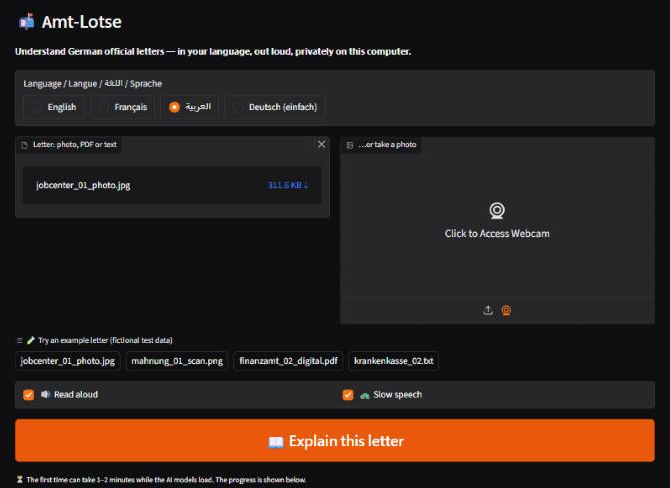
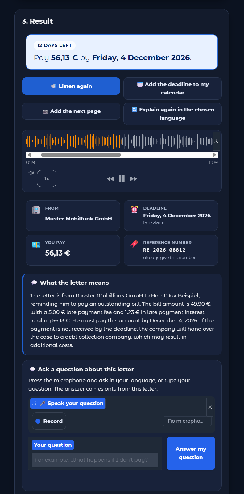
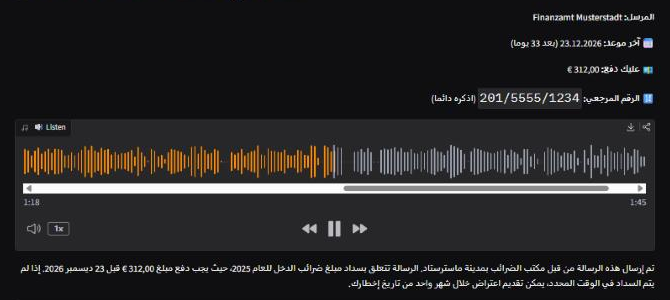
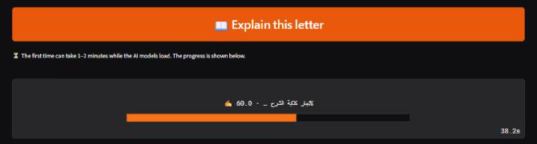

# Amt-Lotse
**An AI assistant that explains German official letters — from a photo, in your language, out loud, and privately on your own machine.**

Letters from the Jobcenter, the Krankenkasse, the Finanzamt or the Ausländerbehörde are hard to understand, even with good German. For many people they are much harder:

- **new immigrants** who are still learning German,
- **blind and visually impaired people** who cannot read a paper letter,
- **older people** who find small print and official language overwhelming.

Amt-Lotse reads the letter — as text, PDF or **a photo**, in a simple **web UI** or on the command line — and tells you in simple words: **who sent it, the deadline, how much you have to pay (or receive), and what you have to do**. In English, French, Arabic or simple German, **read aloud** if you want, and it can **draft a reply** in formal German.

## Screenshots
All screenshots use fictional test letters from `data/`.

**1. Upload a photo, PDF or text — or try an example letter**



**2. Result in English: checked facts first, then audio, then the explanation**



**3. The same in Arabic — card, audio and explanation in the user's language (right-to-left)**



**Progress is shown step by step, in the chosen language, so nobody thinks "nothing is happening"**



## Why local first?
Official letters contain private data (IDs, addresses, tax numbers).
Amt-Lotse runs local models via [Ollama](https://ollama.com) and [Piper](https://github.com/OHF-Voice/piper1-gpl), so **your letters never leave your machine** — no cloud API, no account.

## Example
A scanned debt reminder (`data/photos/mahnung_01_scan.png`):

```text
$ uv run amt-lotse data/photos/mahnung_01_scan.png

Reading the photo with qwen2.5vl:3b ...

============================================================
  From:       Muster Mobilfunk GmbH
  Subject:    2. Mahnung
  Deadline:   04.12.2026  (in 14 days)
  You pay:    56,13 €
  Reference:  RE-2026-08812  (always quote this number)
============================================================

What this means:

The letter is from Muster Mobilfunk GmbH, a company in Musterstadt, to Herr Max
Beispiel. It is a second reminder about an unpaid invoice. Herr Beispiel needs to
pay 56.13 euros by December 4, 2026. If he does not pay on time, the company will
hand over the case to a debt collection agency, which will result in additional costs.
```

Add `--speak` to hear it, `--lang ar` for Arabic, `--reply installments` for a reply draft.

## Features
- **Any input** – `.txt`, PDF (digital text is read directly, scanned pages via OCR), photos (`.jpg`, `.png`)
- **Local OCR** with a vision model (Qwen2.5-VL 3B); unreadable or cut-off photos are detected → "take the photo again"
- **Structured extraction** – sender, deadline, amount, reference number, required action (JSON schema output)
- **Plain-language explanation** in English, French, Arabic or simple German (`--lang en|fr|ar|de`)
- **Read aloud** (`--speak`), designed for accessibility:
  - key facts first, built from the checked extraction (not from free LLM text)
  - dates and amounts spoken as words, reference numbers spelled out
  - slower speech by default, the most important point repeated at the end
  - saved as `.wav`, so it can be replayed or sent to someone
- **Reply drafts** (`--reply`) in formal German: ask for more time, installments, say you already paid, ask for a new appointment, ask a question
  - letter frame (reference number, dates, subject, greeting) built by code; the LLM only writes the body
  - unknown details stay as `[placeholders]`; dates/amounts the LLM invents are detected and replaced with placeholders
  - your own note in any language (`--note "I am sick until 10 December"`) is used and translated
  - a short explanation of the draft in your language
- **Guardrails** on top of the LLMs:
  - yes/no gating for deadlines (an info date is not a deadline)
  - rule-based payment detection: the letter's own wording decides who pays ("überweisen Sie …" vs. "Guthaben", "Erstattung")
  - an amount that exists but cannot be read is shown as **unclear** — never as "you pay nothing"
  - language and script check with automatic retry
- **Evaluation harness** with hand-labelled test letters

## Web UI
```bash
uv run amt-lotse-ui          # opens http://127.0.0.1:7860 — only reachable from this computer
uv run amt-lotse-ui --lan    # also reachable from your phone on the same Wi-Fi (password protected)
```

**From a phone:** with `--lan`, the terminal shows an address like `http://192.168.178.23:7860`, a user name and a fresh password. Open it on the phone, tap the upload box and choose *Camera* to photograph the letter. The photo goes only to your own computer — nothing leaves your home network. Use this only in a network you trust; Windows may ask once whether Python may accept connections in private networks. (The webcam button inside the page needs HTTPS and therefore does not work on phones — use the upload box's camera option instead.)
Language choice, photo/PDF upload or webcam, one-click example letters, a big "Explain" button,
step-by-step progress, auto-playing audio, a "what the computer read" panel for a helper to check,
and the reply drafts with copy and download.

## Quick start
Requirements: Python 3.14+, [uv](https://docs.astral.sh/uv/), [Ollama](https://ollama.com)

```bash
ollama pull qwen2.5:3b       # reads the letter
ollama pull qwen2.5:7b       # writes explanations and replies
ollama pull qwen2.5vl:3b     # reads photos and scans
uv sync

uv run amt-lotse data/eval/mahnung_01.txt                          # English
uv run amt-lotse data/photos/jobcenter_01_photo.jpg --lang ar --speak  # photo, Arabic, read aloud
uv run amt-lotse data/eval/mahnung_01.txt --reply installments     # reply draft
```

Voices for `--speak` are downloaded automatically on first use (into `voices/`).

| Option | Effect |
|---|---|
| `--lang en\|fr\|ar\|de` | language of the explanation, audio and reply summary |
| `--speak` | read aloud and save as `audio/<letter>_<lang>.wav` |
| `--normal-speed` | normal speaking speed (default is slower) |
| `--no-play` | only save the audio file |
| `--reply more-time\|installments\|already-paid\|reschedule\|question` | draft a German reply into `replies/` |
| `--note "..."` | your own information for the reply, in any language |

Models can be changed with `AMT_LOTSE_MODEL` (extraction), `AMT_LOTSE_EXPLAIN_MODEL` (explanation and replies) and `AMT_LOTSE_OCR_MODEL` (photos).

## Architecture

```text
letter (.txt / .pdf / photo)
   │
   ├─ OCR (Qwen2.5-VL 3B, only for photos and scanned pages) ──► truncation / quality check
   ▼
extract (Qwen2.5 3B, JSON schema) ──► rule-based guardrails ──► summary card
   │
   ├──► explain (Qwen2.5 7B, chosen language) ──► language/script check
   ├──► reply   (Qwen2.5 7B body + code-built frame) ──► invented-number check
   └──► speak   (Piper TTS, offline) ──► audio/*.wav
```

| File | Role |
|---|---|
| `src/amt_lotse/ocr.py` | text from `.txt`, PDF or photo; OCR with a local vision model |
| `src/amt_lotse/extract.py` | LLM extraction, date/amount parsing, guardrails |
| `src/amt_lotse/app.py` | Gradio web UI |
| `src/amt_lotse/pipeline.py` | shared pipeline for the UI, summary card in 4 languages |
| `src/amt_lotse/cli.py` | `amt-lotse` command, explanation, language check |
| `src/amt_lotse/reply.py` | reply drafts in formal German |
| `src/amt_lotse/speak.py` | spoken script in 4 languages, Piper TTS |
| `src/amt_lotse/evaluate.py` | scores the extractor against `data/eval/` |
| `src/amt_lotse/evaluate_text.py` | rule-based checks for explanation and reply texts |

## Evaluation
`uv run python -m amt_lotse.evaluate` scores the extractor against 12 hand-labelled letters in `data/eval/` (Jobcenter, Ausländerbehörde, Finanzamt, Krankenkasse, Beitragsservice, landlord, university, debt reminder).

The test letters contain deliberate traps: several dates where only one is a deadline, a refund that looks like a payment, invoice + fees + total, two reference numbers, amounts like `1.343,27 €`, and a relative deadline ("innerhalb von vier Wochen").

| Model | Fields correct | Time (12 letters) |
|---|---|---|
| qwen2.5:3b + guardrails | **36/36** | ~35 s |

### Explanation and reply texts
`uv run python -m amt_lotse.evaluate_text --lang en` (or `fr`, `ar`, `de`) runs the full pipeline on all eval letters and checks the free text with rules — no human labels, no "LLM judge":

| Explanation | Reply draft |
|---|---|
| mentions the right deadline and amount | no invented dates/amounts left |
| no invented dates or amounts | first person singular ("ich", never "wir") |
| no false reassurance ("nothing will happen", "does not specify") | formal "Sie", never "du" |
| right language and script | exactly one closing, reference number included, 1–6 sentences |

It also counts how often the guardrail had to replace numbers the model invented in a reply. A JSON report with every text is written to `eval_results/`.

**Latest run** (English, 12 letters, Qwen2.5 7B for the texts, ~14 min):

| Part | Result |
|---|---|
| Explanations | **64/64** checks — right deadline and amount every time, nothing invented, no false reassurance |
| Replies | 67/72 checks with the first version of the rules |

Reading the failed replies changed both the rules and the guardrail:
- 4 of the 5 "not first person" failures were correct German ("…wenn **wir** den Termin verschieben könnten" = you and I). The check now only fails if the writer never speaks as "ich" — which leaves 1 real failure (a whole letter written as "Wir …").
- 2 instalment replies said "in **drei** Monatsraten": an invented number, written as a word, that neither the guardrail nor the eval had seen. Number words (*zwei* … *zwölf*) not in the letter are now replaced with `[Anzahl]` as well.

Rules cannot catch every meaning error: an explanation that mixes up the appeal period (*Einspruch*) with a payment consequence still passes, and small grammar mistakes in the German replies ("in einem einzigen Überweisung") are not checked. Those are the next things to measure.

What the extraction eval taught us:
- The small model reads amounts and dates well, but is **unreliable on who pays** — it flipped between runs and between `.txt` and PDF versions of the same letter. That decision is now made by rules on the letter's own wording.
- 3B and 7B scored the same on extraction, with 3B about 5× faster → 3B extracts, 7B writes (3B often failed to answer in Arabic).

`data/photos/` contains a scan, a tilted phone photo, a digital PDF and a scanned PDF made from the test letters. All test letters are fictional and marked as test data.

## Limitations
- Explanation and reply texts are checked by rules, not for meaning: the 7B model sometimes mixes things up (e.g. the appeal period vs. a consequence of not paying). Dates and amounts in the summary card and audio are checked by code — the free text only partly.
- The German in reply drafts is understandable but not always grammatically perfect. Read it before sending, or have someone check it.
- OCR can silently miss a paragraph; the transcription is saved as `<file>.ocr.txt` so a helper can compare it with the paper letter.
- The payment rules were built and tested on the same 12 letters; unusual wording may slip through.
- This is not legal advice. For important decisions, ask an advice centre (Beratungsstelle).

## Roadmap
- [x] Local LLM reads a sample letter
- [x] Structured extraction + evaluation set (12 letters with traps, 36/36)
- [x] Explanations in English, French, Arabic and simple German
- [x] Read aloud with offline TTS, accessibility-first
- [x] OCR for photos and scanned PDFs
- [x] Reply drafts in formal German
- [x] Web UI with photo upload, example letters, progress steps and audio
- [x] Rule-based evaluation for explanation and reply texts
- [x] Use from a phone on the same Wi-Fi (camera upload, password protected)
- [ ] Catch meaning errors in explanations (e.g. appeal period vs. consequence)
- [ ] Voice input, MCP server + agent, Docker
